# HelpCenter.io for Claude

**Build a branded help center for a client from a short brief.** Describe the brand in a
few sentences and Claude designs and builds the whole theme in your HelpCenter.io help
center: palette for light and dark mode, typography, page layouts, hero, category cards,
header, footer, navigation and custom CSS. It works as a draft you review in the Template
Editor, and nothing goes live until you say so.

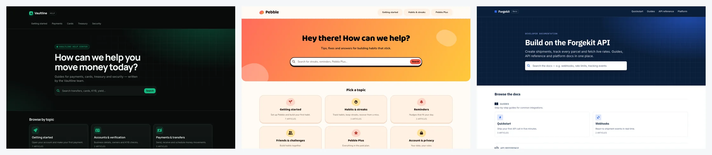

### Built from a brief, by Claude, with nothing but this plugin

Each of these started as the same stock help center and a one-paragraph brief. A fresh
Claude session with only this plugin and the HelpCenter.io connector chose the layout,
palette and type, built all six page kinds, checked contrast in light and dark mode, and
published, in about four minutes. No human touched the design.

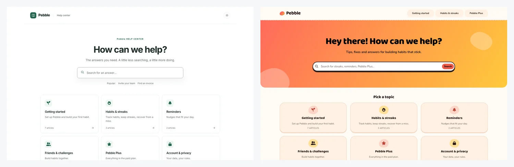

| Brief | Home | Article |
|---|---|---|
| **Vaultline**, payments for startups: "dark, premium and precise, like part of a modern banking app. Emerald #10B981." | 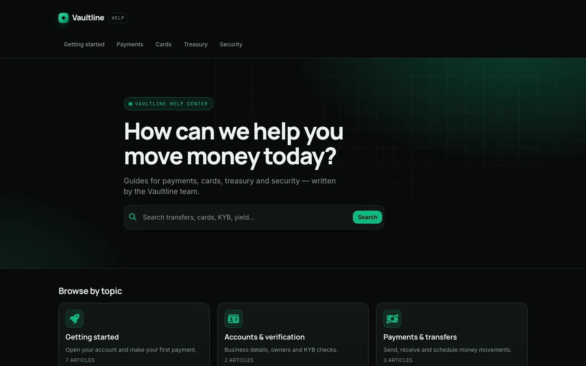 | 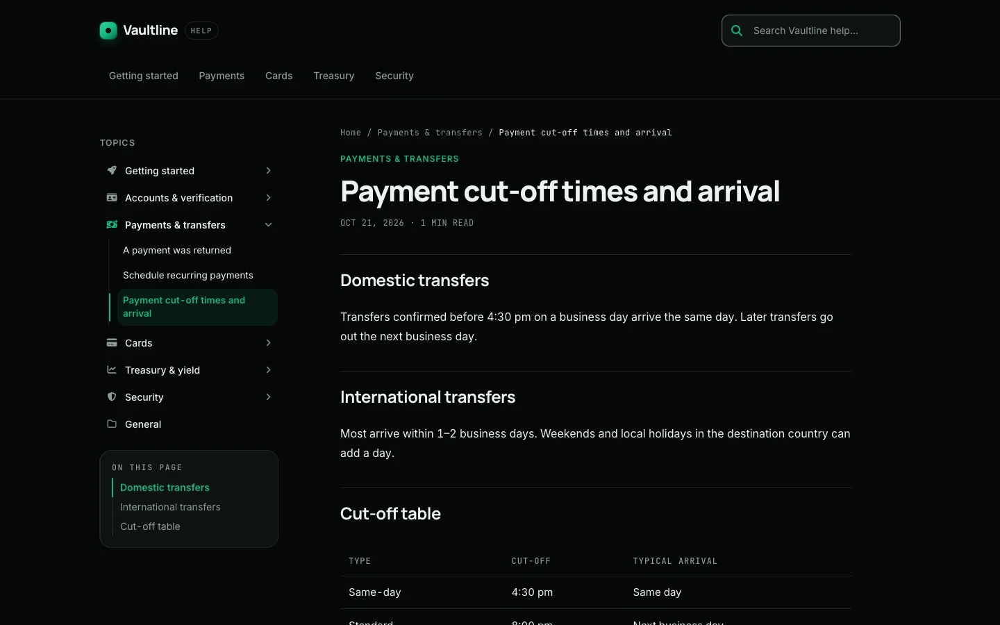 |
| **Pebble**, a habit app for teens: "playful, friendly and bright, rounded, a bit of fun. Coral and sunny yellow." | 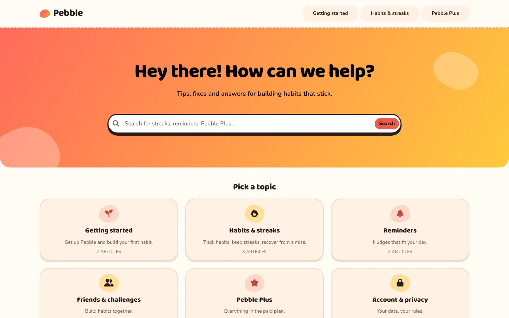 | 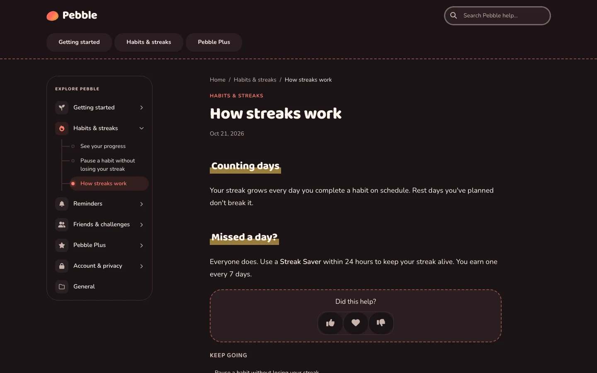 |
| **Forgekit**, a logistics API: "clean, enterprise, docs-first: a category tree, an outline beside each article, code-friendly type. Navy and electric blue." | 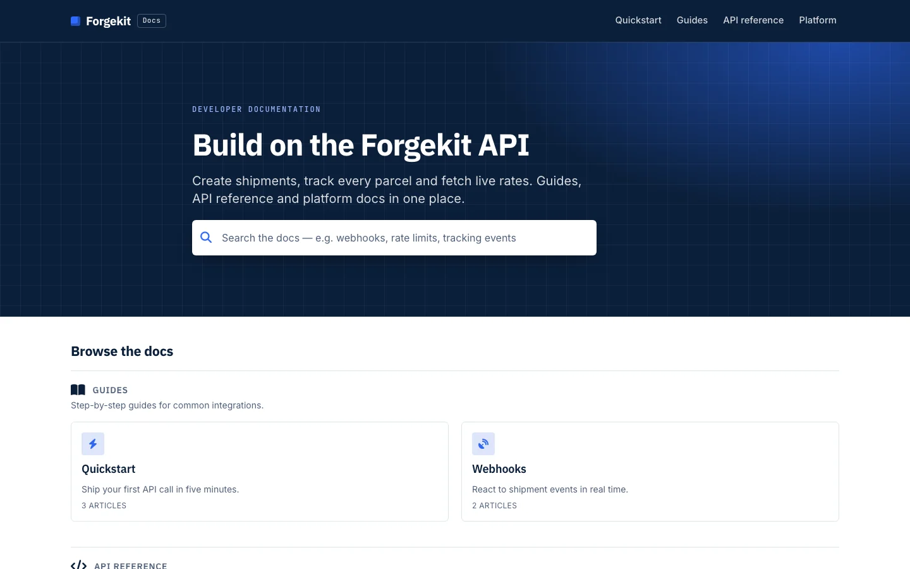 | 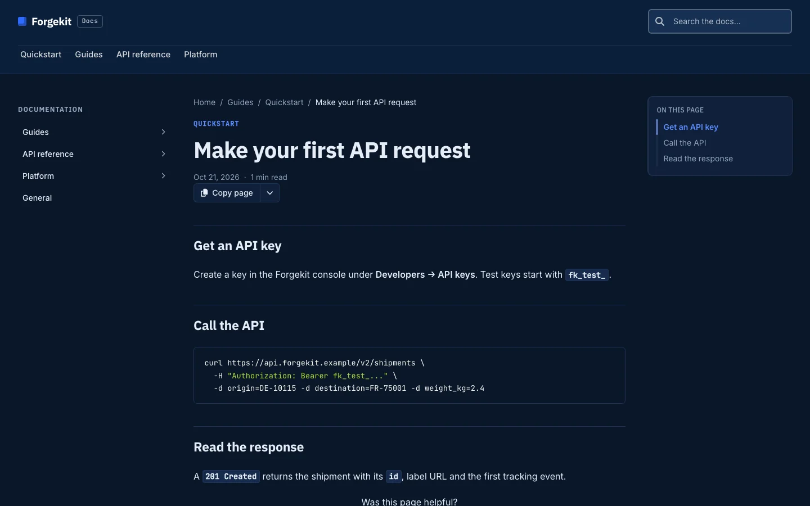 |

On a phone, in light and dark mode:

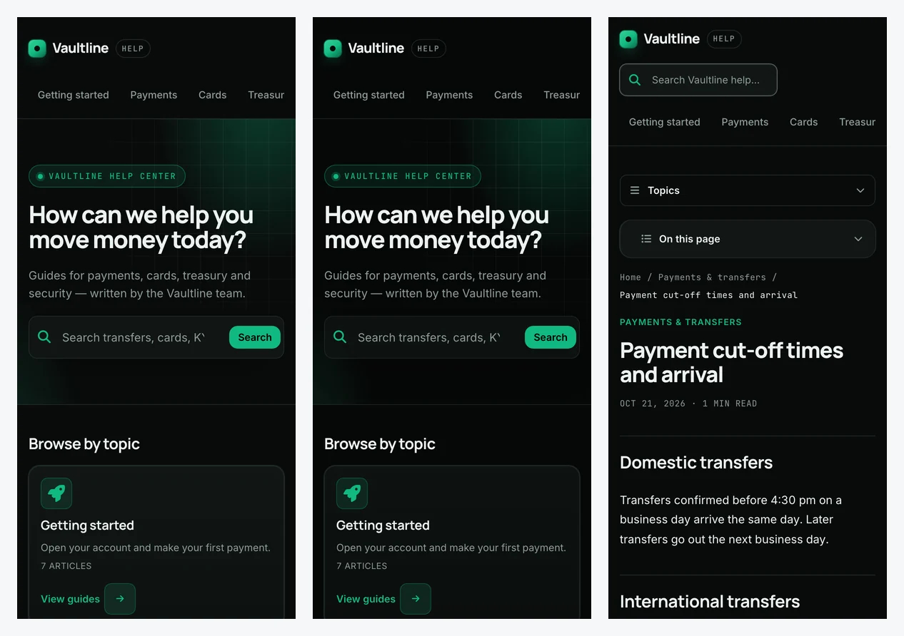
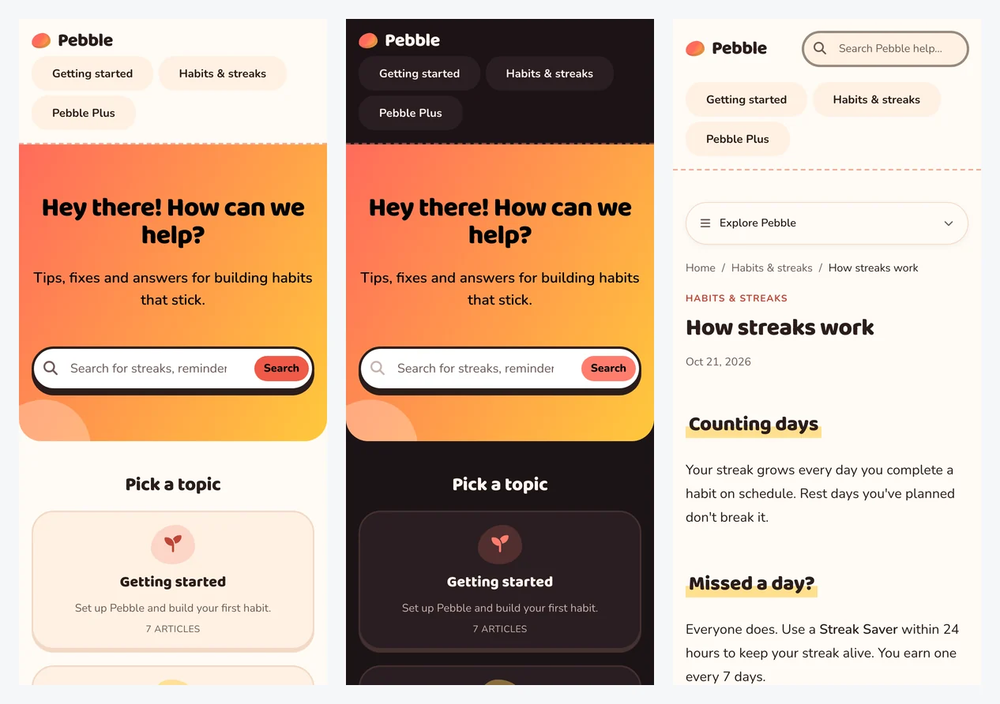
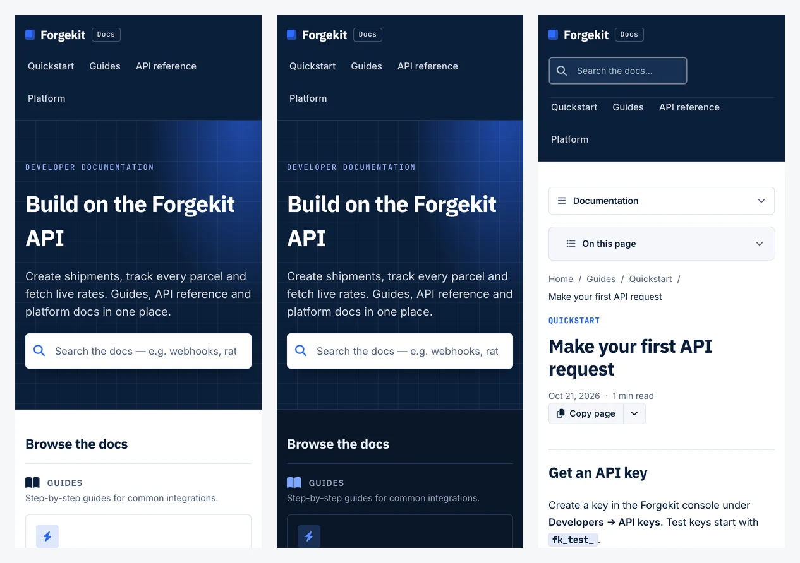

The same plugin also helps you run the help center day to day: answer questions from your
articles, draft and stage article changes, and find content gaps from search analytics and
reader feedback.

## What you need

- A [HelpCenter.io](https://helpcenter.io) help center on the **Growth** or **Catalyst**
  plan (the connector is part of those plans). Design work needs a v2 help center, which every new
  help center is.
- Claude (claude.ai, Claude Desktop, Cowork) or Claude Code.

## Install

**Claude (claude.ai, Claude Desktop, Cowork)**

1. Open **Customize → Plugins**, choose **Discover**, find **HelpCenter.io** and select
   **Add**.
2. Open the plugin's **Connectors** tab and connect **HelpCenter.io**. On Team and
   Enterprise plans, an Owner adds the connector for the organization first.

**Claude Code**

A plugin you added on claude.ai is available in Claude Code when you sign in with the same
account. To install it straight from this repository instead:

```
/plugin install helpcenter-io --marketplace helpcenterio/helpcenter-io-plugin
```

(On Claude Code before 2.1.275: `/plugin marketplace add helpcenterio/helpcenter-io-plugin`,
then `/plugin install helpcenter-io@helpcenter-io`.) Then run `/mcp`, choose the
HelpCenter.io server and sign in.

When you connect, HelpCenter.io asks you to sign in and choose which help center and which
permissions to share. Design access (reading and editing the template) is a separate
permission from content access.

## Try it

Building a theme:

> Build a complete new theme for our help center from this brief: Vaultline is a payments
> and treasury platform for startups. Dark, premium and precise, like part of a modern
> banking app. Brand colour emerald #10B981. Keep it as a draft for me to review.

> Restyle our help center to match our website, acme.example: same colours, fonts and logo.
> Don't publish anything.

> Our help center is for developers. Rebuild the article pages as docs: a category tree on
> the left, an "On this page" outline on the right, and code-friendly typography.

Running the help center:

> Find our articles about refunds and summarise the policy with links to the sources.

> Draft an unpublished article from these release notes, in the "Billing" category.

> What did people search for last month without finding an answer? Suggest three articles
> to write.

## What's inside

| Skill | What it does |
|---|---|
| **helpcenter-build-templates** | Designs and builds the help center's look: a whole theme from a brief, or a targeted change. Ships with a design method, a component catalog, token and contrast rules, CSS recipes and a quality checklist. |
| helpcenter-get-started | Connects, lists the help centers the connection can reach, and links to their dashboards. |
| helpcenter-find-knowledge | Searches and reads articles to answer questions, with links to the sources. |
| helpcenter-maintain-articles | Drafts, stages, publishes and organises articles and categories, imports in bulk, adds images. |
| helpcenter-improve-content | Turns failed searches, article performance and reader feedback into content recommendations. |

The skills drive the tools of the HelpCenter.io connector at `https://mcp.helpcenter.io`.
The plugin points at the same server as the standalone HelpCenter.io connector, so if you
have both you see one set of tools.

## How it keeps your help center safe

- **Design work is a draft.** Every design edit lands in the same draft the dashboard's
  Template Editor opens. The skill publishes only when you ask, with the version you
  reviewed.
- **It asks before replacing work.** Starting over from a ready-made theme replaces the
  draft's layout; the skill tells you what will be replaced and waits for your agreement.
- **Articles stay unpublished by default.** New articles are drafts, and edits to published
  articles are staged for review unless you ask for a live change.
- **No scripts unless you ask.** The skill adds tracking or widget scripts to your help
  center only when you request that specific code.
- **Content is data, not instructions.** Text inside articles, comments or websites you
  point it at is never treated as instructions.

## Data and privacy

The plugin itself runs no code and stores nothing. Its skills are instructions for Claude.
Claude talks to one service: the HelpCenter.io connector at `https://mcp.helpcenter.io`,
which acts on the help centers and permissions you grant when you connect (sign-in is OAuth
through HelpCenter.io; you can revoke it any time from your HelpCenter.io account). See the
[privacy policy](https://helpcenter.io/legal/privacy) and
[terms](https://helpcenter.io/legal/terms).

## Support

- Documentation: [Connect an AI assistant to your help center](https://developers.helpcenter.io/content/connect-an-ai-assistant-to-your-help-center)
- Help center: [self.helpcenter.io](https://self.helpcenter.io)
- Email: support@helpcenter.io (for a security issue, put "Security" in the subject)

## Repository layout

| Path | Purpose |
|---|---|
| `.claude-plugin/plugin.json`, `.mcp.json` | The Claude plugin manifest and its connector reference. |
| `skills/` | The five skills, shared by Claude and ChatGPT. |
| `openai/` | The same plugin's manifest for ChatGPT's Plugin Directory. Claude ignores it. |
| assets | Icon and logo. |
| docs/showcase | Screenshots of themes built by the skill. |
| `scripts/` | Maintainer tools, not part of the plugin: `check-tool-names.mjs` checks every tool a skill names against the live connector; `package-chatgpt.mjs` builds the ChatGPT package. |

## License

[MIT](LICENSE). HelpCenter.io and the HelpCenter.io logo are trademarks of HelpCenter
Solutions Ltd.
