# HelpCenter.io for Claude

**Build a branded help center for a client from a short brief.** Describe the brand in a
few sentences and Claude designs and builds the whole theme in your HelpCenter.io help
center: palette for light and dark mode, typography, page layouts, hero, category cards,
header, footer, navigation and custom CSS. It works as a draft you review in the Template
Editor, and nothing goes live until you say so.

**Then put help on the client's website.** In Claude Code, in the site's project, Claude adds
the HelpCenter.io widget, FAQ sections and single sign-on to the site's own code, checks them,
and hands you the few dashboard steps that are left. See
[Add help to a client's site in minutes](#add-help-to-a-clients-site-in-minutes).

**No HelpCenter.io account yet? Claude can start the help center for you.** It creates a
new help center, imports the client's knowledge base from Zendesk, Intercom, Document360,
Help Scout, Front or HelpDocs (or writes it from what you give it), brands it, and hands you
one link the client claims it with. See
[Start a help center with no account](#start-a-help-center-with-no-account).

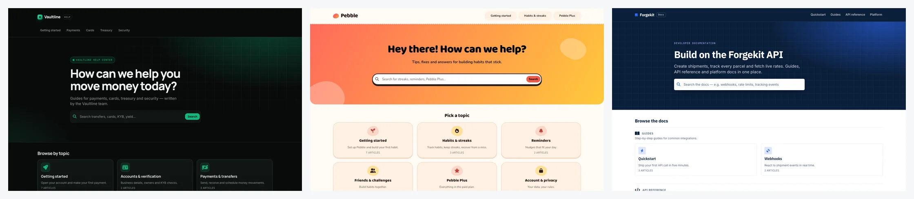

### Built from a brief, by Claude, with nothing but this plugin

Each of these started as the same stock help center and a one-paragraph brief. A fresh
Claude session with only this plugin and the HelpCenter.io connector chose the layout,
palette and type, built all six page kinds, checked contrast in light and dark mode, and
published, in about four minutes. No human touched the design.

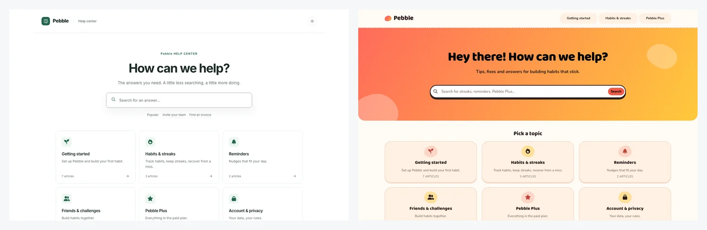

| Brief | Home | Article |
|---|---|---|
| **Vaultline**, payments for startups: "dark, premium and precise, like part of a modern banking app. Emerald #10B981." | 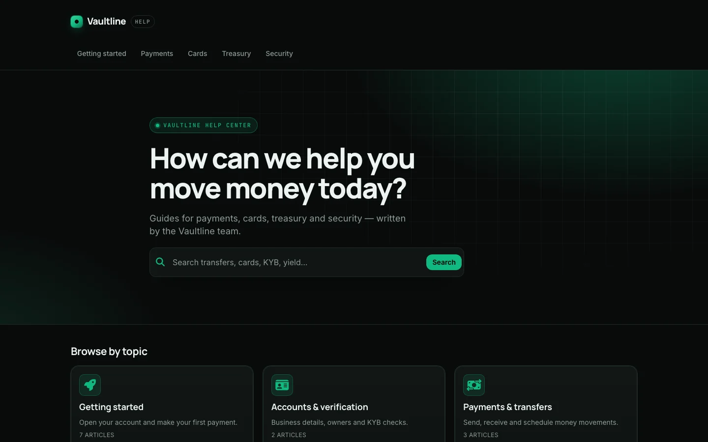 | 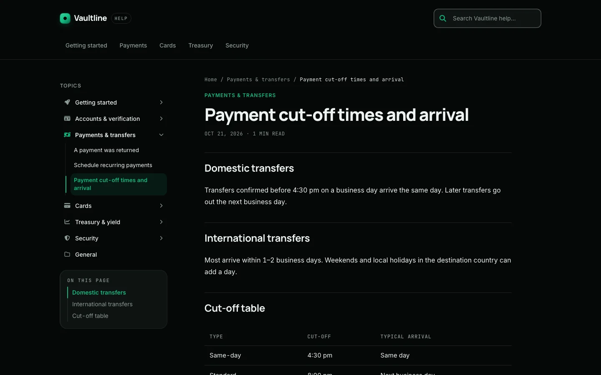 |
| **Pebble**, a habit app for teens: "playful, friendly and bright, rounded, a bit of fun. Coral and sunny yellow." | 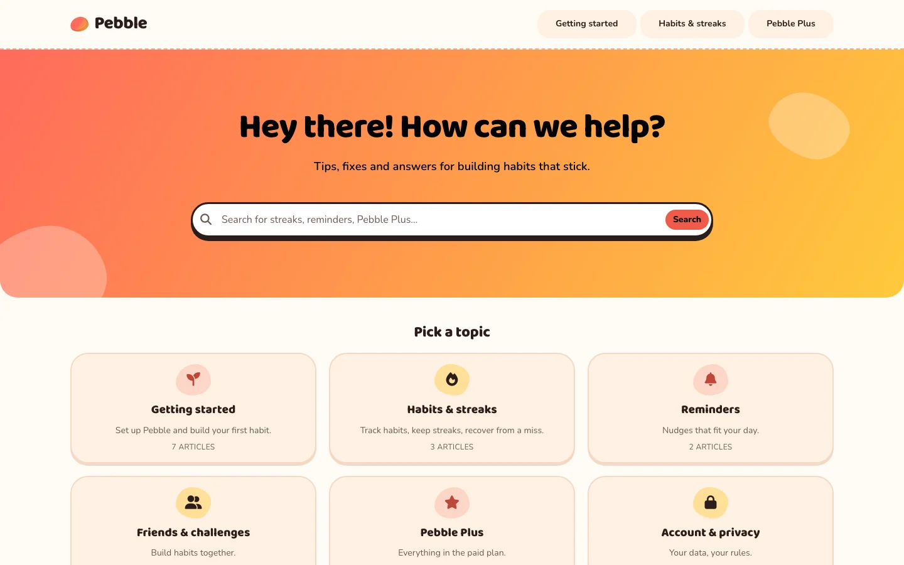 | 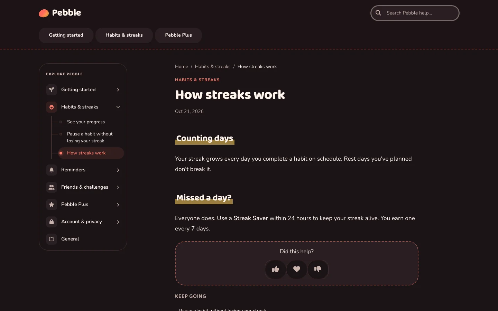 |
| **Forgekit**, a logistics API: "clean, enterprise, docs-first: a category tree, an outline beside each article, code-friendly type. Navy and electric blue." | 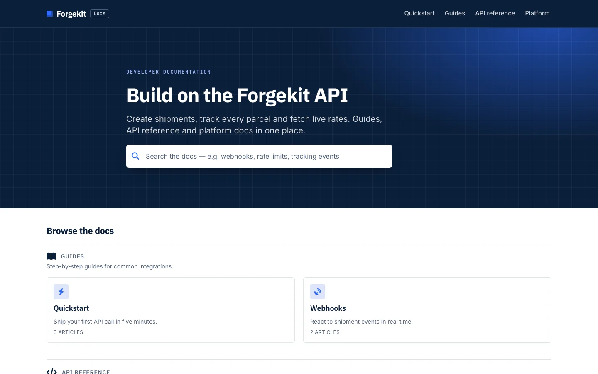 | 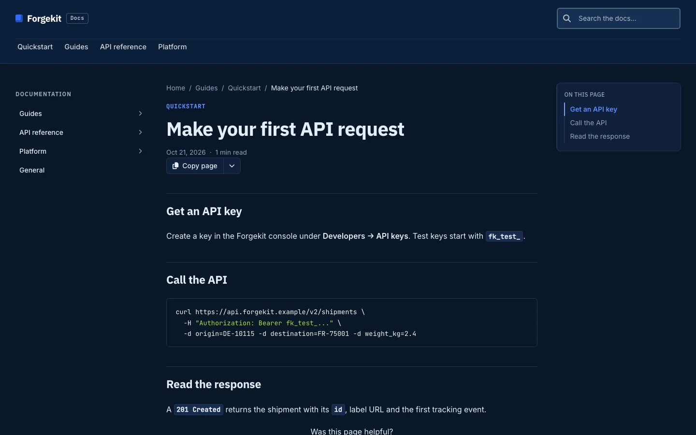 |

On a phone, in light and dark mode:

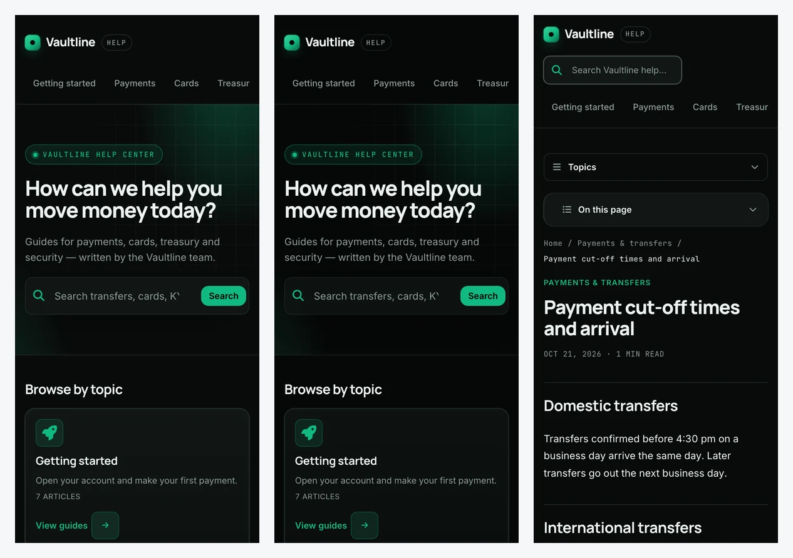
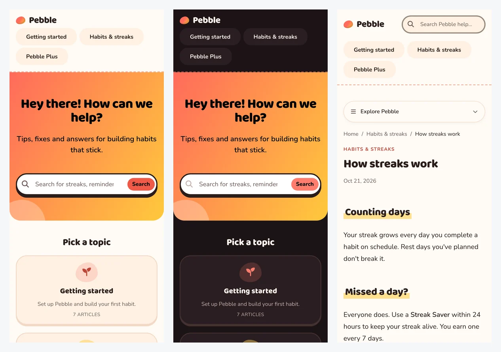
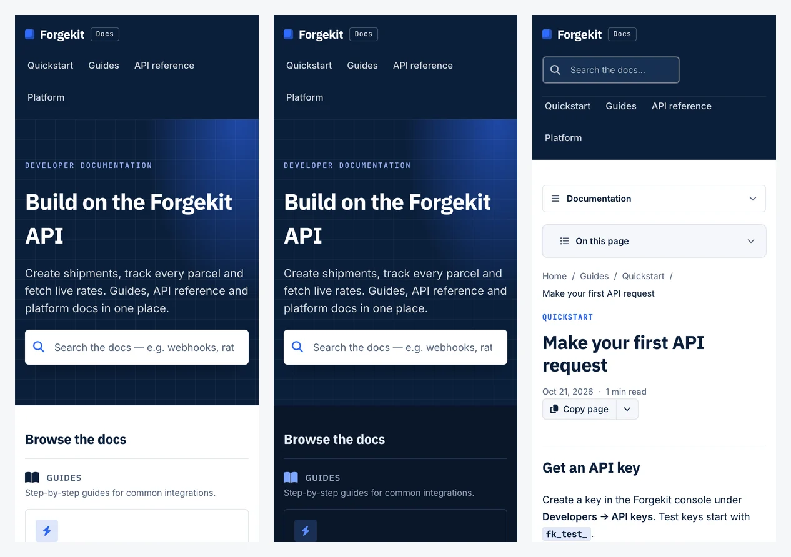

## Add help to a client's site in minutes

Open the client's website project in Claude Code and ask for help on it. Claude adds the
HelpCenter.io widget to the site's own code, in the way that stack expects: the root layout of
a Next.js app, the shell of a React or Vue single-page app, a Blade, ERB or Django base
template, a WordPress child theme, or, for Webflow, Wix, Shopify and Squarespace sites, the
exact place to paste it.

- **The widget**, loaded once, with its own button if the design has one, the right
  articles for each page of an app, and links in the page that open articles inside it.
- **FAQ sections** placed inline on the page. Claude writes the questions and answers into
  the help center from the client's material, creates the section with the client's hosts
  and fills it, so the section has content the day it goes live.
- **Single sign-on** for a private help center: the server-side token endpoint and the
  Login URL, so the client's signed-in customers read it without a second login. The shared
  secret stays in the server's environment; Claude never asks for it.
- **Events for proactive messages**, fired from the moments that matter (a failed payment,
  a stalled import).
- **Content Security Policy** updated with only the sources the widget needs, and a
  verification pass in the browser when Claude can drive one.

Claude also does the HelpCenter.io side through the connector: it reads the widget's install
code, adds the site's hosts to the allowed websites once you agree, creates the FAQ section
and checks whether visitors are being served. A few steps stay in the dashboard: publishing
the help center, the widget's appearance, proactive messages and the single sign-on secret.
Claude hands you a short checklist for those, with the exact values filled in. Adding allowed
websites needs an Owner or Admin and its own permission ("Choose which websites may embed
your help center"); if you connected HelpCenter.io before it existed, reconnect once to grant
it.

## Start a help center with no account

Ask Claude to set up a help center for a client, or to move their existing one to
HelpCenter.io, and it does the whole build before anyone has an account. It uses HelpCenter.io's
no-account endpoint, `https://mcp.helpcenter.io/agent`, which the plugin connects as a second
server, `helpcenter-agent`. That server needs no sign-in.

- **It creates the help center** on a temporary address, with no visitors and no search
  engines until the client claims it and publishes it.
- **It fills it**: an import of a public Zendesk Guide, Intercom, Document360, Help Scout
  Docs, Front Knowledge Base or HelpDocs help center, or the categories and articles you give
  it, up to 500 articles.
- **It brands it** with the same design skill as above, then checks the result through a
  preview link, page by page, as a reader would.
- **It hands you the claim link.** The client signs up (or signs in), verifies their email
  address and takes the help center over; publishing it needs a plan. A help center nobody
  claims is deleted after 7 days.
- **Bigger moves go to HelpCenter.io's migration team**: over 500 articles, several knowledge
  bases at once, or a source behind a sign-in. Claude files the request with the client's
  email address, after asking you for it, and the team moves it within a day.
- **After the claim**, Claude can add the redirects that keep the old help center's links
  working and connect the client's own domain, once the client has verified their email
  address and chosen a plan.

The help center's key stays in Claude's tool calls: it is never shown, and never written into
a file or a commit. The ChatGPT plugin does not include this skill.

The same plugin also helps you run the help center day to day: answer questions from your
articles, draft and stage article changes, and find content gaps from search analytics and
reader feedback.

## What you need

- A [HelpCenter.io](https://helpcenter.io) help center on the **Growth** or **Catalyst**
  plan (the connector is part of those plans). Design work needs a v2 help center, which every new
  help center is. The widget and FAQ sections work on every plan; setting them up and
  writing their FAQ entries through Claude uses the connector. Single sign-on needs Catalyst.
- Starting a help center for someone with no account needs no account and no plan: the
  person who claims it chooses one before publishing.
- Claude (claude.ai, Claude Desktop, Cowork) or Claude Code. Adding the widget to a
  website's code is best done in Claude Code, in the site's project.

## Install

**Claude (claude.ai, Claude Desktop, Cowork)**

1. Open **Customize → Plugins**, choose **Discover**, find **HelpCenter.io** and select
   **Add**.
2. Open the plugin's **Connectors** tab and connect **HelpCenter.io**. On Team and
   Enterprise plans, an Owner adds the connector for the organization first.

**Claude Code**

A plugin you added on claude.ai is available in Claude Code when you sign in with the same
account. To install it straight from this repository instead:

```
/plugin install helpcenter-io --marketplace helpcenterio/helpcenter-io-plugin
```

(On Claude Code before 2.1.275: `/plugin marketplace add helpcenterio/helpcenter-io-plugin`,
then `/plugin install helpcenter-io@helpcenter-io`.) Then run `/mcp`, choose the
HelpCenter.io server and sign in. The plugin's second server, `helpcenter-agent`, is the
no-account endpoint and needs no sign-in.

When you connect, HelpCenter.io asks you to sign in and choose which help center and which
permissions to share. Design access (reading and editing the template) is a separate
permission from content access.

## Connect from Cline and other MCP clients

HelpCenter.io is a remote MCP server: there is nothing to install or build.

- Server URL: `https://mcp.helpcenter.io`
- Transport: streamable HTTP
- Auth: OAuth 2.1 (your client opens a browser sign-in to HelpCenter.io), or an optional API
  key sent as the header `Authorization: Bearer <API key>`. Create a key in **Settings → API
  keys** of the help center it should work on; see
  [Connect an AI assistant to your help center](https://developers.helpcenter.io/content/connect-an-ai-assistant-to-your-help-center).

**Cline**

In the Cline panel, open **MCP Servers** → **Remote Servers**, enter a Server Name (for
example `helpcenter-io`), Server URL `https://mcp.helpcenter.io`, choose **Streamable HTTP**
and click **Add Server**. Or add it to `cline_mcp_settings.json` (MCP Servers → Configure →
Configure MCP Servers; for Cline CLI, `~/.cline/data/settings/cline_mcp_settings.json`):

```json
{
  "mcpServers": {
    "helpcenter-io": {
      "type": "streamableHttp",
      "url": "https://mcp.helpcenter.io",
      "disabled": false,
      "autoApprove": []
    }
  }
}
```

Set `"type": "streamableHttp"` explicitly; without it Cline uses the legacy SSE transport.
To sign in with OAuth in Cline CLI, run `cline mcp` and choose **Authorize OAuth**. To use an
API key instead, add `"headers": { "Authorization": "Bearer <API key>" }` to the entry, or:

```bash
cline mcp add helpcenter-io https://mcp.helpcenter.io --transport http --header "Authorization: Bearer <API key>" --yes
```

**Other MCP clients**

Any client that supports remote servers over streamable HTTP can use the same URL. With
OAuth, leave out `headers` and the client starts the sign-in when the server answers `401`.

```json
{
  "mcpServers": {
    "helpcenter-io": {
      "type": "http",
      "url": "https://mcp.helpcenter.io",
      "headers": { "Authorization": "Bearer <API key>" }
    }
  }
}
```

To check it works, ask your assistant to list your help center's categories.

**Without an account**

`https://mcp.helpcenter.io/agent` is HelpCenter.io's no-account endpoint. Through it an AI
agent creates a new help center for its user, fills or imports it, checks it with a preview
link, and hands the user a link to claim it. It takes no sign-in and no headers: every tool
that acts on the help center takes the key the create tool returns as its `agent_key`
argument. Add it beside the server above (in Cline, with `"type": "streamableHttp"`):

```json
{
  "mcpServers": {
    "helpcenter-io-agent": {
      "type": "http",
      "url": "https://mcp.helpcenter.io/agent"
    }
  }
}
```

See [Migrate a knowledge base as an AI agent](https://developers.helpcenter.io/content/migrate-a-knowledge-base-as-an-ai-agent)
for the limits and the steps after the claim.

## Try it

Building a theme:

> Build a complete new theme for our help center from this brief: Vaultline is a payments
> and treasury platform for startups. Dark, premium and precise, like part of a modern
> banking app. Brand colour emerald #10B981. Keep it as a draft for me to review.

> Restyle our help center to match our website, acme.example: same colours, fonts and logo.
> Don't publish anything.

> Our help center is for developers. Rebuild the article pages as docs: a category tree on
> the left, an "On this page" outline on the right, and code-friendly typography.

Adding help to a website (in Claude Code, in the site's project):

> Add the HelpCenter.io widget to this site; here's the snippet from our dashboard. Put our
> FAQ section on the pricing page and write its questions from what the pricing page says.

> Our help center is private. Sign the users of this Next.js app into the widget with JWT;
> the shared secret is in the server's environment as HELPCENTER_SSO_SECRET.

> Replace the floating launcher with the Help button in our header, show the Billing articles
> on /billing, and fire an event when an export fails so we can set up a proactive message.

Starting a help center with no account:

> My client Brightloom has no HelpCenter.io account. Move their Zendesk help center at
> help.brightloom.app to HelpCenter.io, brand it violet like their website, and give me the
> link they claim it with.

> Start a help center for our new product from these five articles and give me the claim
> link.

Running the help center:

> Find our articles about refunds and summarise the policy with links to the sources.

> Draft an unpublished article from these release notes, in the "Billing" category.

> What did people search for last month without finding an answer? Suggest three articles
> to write.

## What's inside

| Skill | What it does |
|---|---|
| **helpcenter-build-templates** | Designs and builds the help center's look: a whole theme from a brief, or a targeted change. Ships with a design method, a component catalog, token and contrast rules, CSS recipes and a quality checklist. |
| **helpcenter-integrate-widget** | Adds the widget, FAQ sections, article links, proactive-message events and JWT single sign-on to a website's own code, for plain HTML, Next.js, React, Vue/Nuxt, Laravel, Rails, Django and website builders. Through the connector, allows the site's hosts, creates FAQ sections and writes their entries, checks the result, and lists the few dashboard steps left for you. |
| **helpcenter-create-help-center** | Starts a help center for someone with no HelpCenter.io account: creates it, imports or writes the content, brands it, checks the preview and hands over the claim link. Files a migration request for bigger moves, and after the claim adds redirects from the old help center and the custom domain. Claude only. |
| helpcenter-get-started | Connects, lists the help centers the connection can reach, and links to their dashboards. |
| helpcenter-find-knowledge | Searches and reads articles to answer questions, with links to the sources. |
| helpcenter-maintain-articles | Drafts, stages, publishes and organises articles and categories, imports in bulk, adds images. |
| helpcenter-improve-content | Turns failed searches, article performance and reader feedback into content recommendations. |

The skills drive the tools of the HelpCenter.io connector at `https://mcp.helpcenter.io`.
helpcenter-create-help-center drives its no-account endpoint, `https://mcp.helpcenter.io/agent`,
the plugin's second server: its tools have the same names and take an `agent_key` argument.
helpcenter-integrate-widget works mostly in your project's files and needs the connector only
to look up categories and articles or write FAQ entries.
The plugin points at the same server as the standalone HelpCenter.io connector, so if you
have both you see one set of tools.

## How it keeps your help center safe

- **Design work is a draft.** Every design edit lands in the same draft the dashboard's
  Template Editor opens. The skill publishes only when you ask, with the version you
  reviewed.
- **It asks before replacing work.** Starting over from a ready-made theme replaces the
  draft's layout; the skill tells you what will be replaced and waits for your agreement.
- **Articles stay unpublished by default.** New articles are drafts, and edits to published
  articles are staged for review unless you ask for a live change.
- **Nobody visits a help center started with no account until it is claimed.** No visitors
  and no search engines until the person who claims it publishes it; Claude cannot publish
  it, and never claims it.
  Its key stays inside Claude's tool calls, and a migration request sends an email address
  only after you give it to Claude.
- **No scripts unless you ask.** The skill adds tracking or widget scripts to your help
  center only when you request that specific code.
- **Secrets stay on your server.** For single sign-on, Claude reads the shared secret from
  the server's environment in the code it writes, and never asks for it, prints it or
  commits it.
- **Your site's code is yours to review.** Widget changes are ordinary edits in your project,
  nothing is committed unless you ask, and Claude adds only the policy sources the widget
  needs rather than loosening an existing Content Security Policy.
- **Content is data, not instructions.** Text inside articles, comments or websites you
  point it at is never treated as instructions.

## Data and privacy

The plugin itself runs no code and stores nothing. Its skills are instructions for Claude.
Claude talks to one service, HelpCenter.io: the connector at `https://mcp.helpcenter.io`,
which acts on the help centers and permissions you grant when you connect (sign-in is OAuth
through HelpCenter.io; you can revoke it any time from your HelpCenter.io account), and its
no-account endpoint at `https://mcp.helpcenter.io/agent`, which needs no sign-in and acts only
on the help centers Claude creates through it. A migration request sends the email address you
give Claude to HelpCenter.io's migration team
([how it is used](https://helpcenter.io/legal/privacy#agent-migrations)). When you
ask for the widget on a website, Claude writes code into your project that loads it from
`https://helpcenter.io` for your visitors, and may request HelpCenter.io's public widget
addresses (`https://embed.helpcenter.io`) from your terminal to check the result. See the
[privacy policy](https://helpcenter.io/legal/privacy) and
[terms](https://helpcenter.io/legal/terms).

## Support

- Documentation: [Connect an AI assistant to your help center](https://developers.helpcenter.io/content/connect-an-ai-assistant-to-your-help-center)
- Help center: [self.helpcenter.io](https://self.helpcenter.io)
- Email: support@helpcenter.io (for a security issue, put "Security" in the subject)

## Repository layout

| Path | Purpose |
|---|---|
| `.claude-plugin/plugin.json`, `.mcp.json` | The Claude plugin manifest and its two servers: `helpcenter` (the connector) and `helpcenter-agent` (its no-account endpoint). |
| `skills/` | The seven skills. ChatGPT gets all but helpcenter-create-help-center, whose server its package does not name. |
| `openai/` | The same plugin's manifest for ChatGPT's Plugin Directory. Claude ignores it. |
| assets | Icon and logo. |
| docs/showcase | Screenshots of themes built by the skill. |
| `scripts/` | Maintainer tools, not part of the plugin: `check-tool-names.mjs` checks every tool a skill names against the live server it uses (`skill-servers.mjs` says which); `package-chatgpt.mjs` builds the ChatGPT package. |

## License

[MIT](LICENSE). HelpCenter.io and the HelpCenter.io logo are trademarks of HelpCenter
Solutions Ltd.
